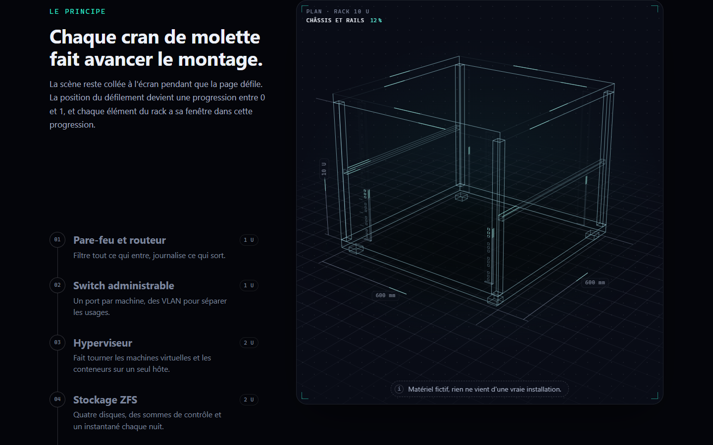
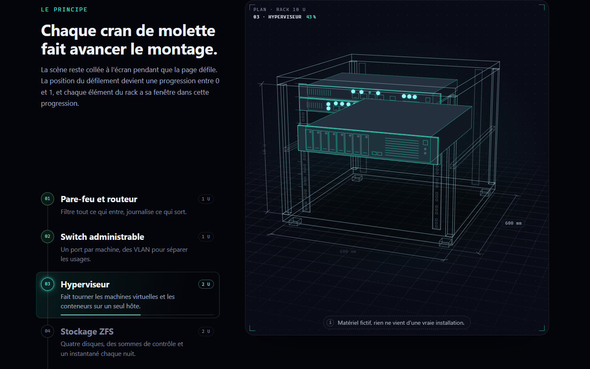
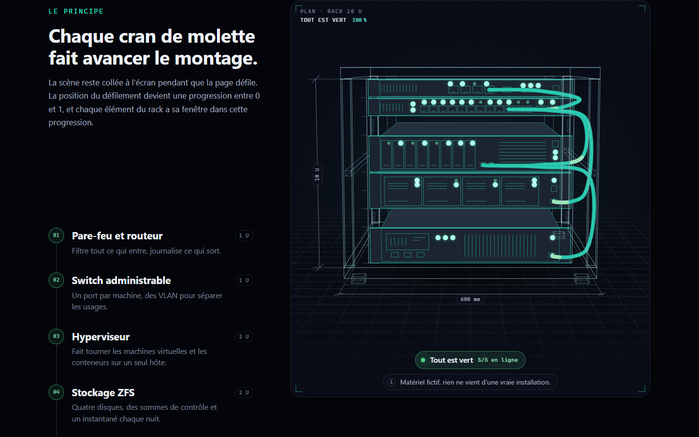

# rack-scroll

Un rack serveur qui se monte pièce par pièce pendant qu'on fait défiler la page.
C'est l'animation de la page d'accueil de [tlnetwork.fr](https://tlnetwork.fr). Ici
j'explique comment elle marche, et je la refais dans une démo sans aucune
bibliothèque.

| 12 % | 43 % | 100 % |
| :-: | :-: | :-: |
|  |  |  |

## Lancer la démo

Ouvre `demo/index.html` dans le navigateur, directement depuis le disque. Il n'y a
rien à installer et rien à compiler.

Deux paramètres d'URL servent pour les tests et les captures :

- `?p=0.43` fige la progression à 43 % (la page n'a plus besoin de défiler) ;
- `?motion=reduced` ou `?motion=full` force le mode d'animation.

Le bouton en haut de la page bascule entre animations activées et réduites, sans
recharger.

## Ce qui se passe pendant le défilement

Tout est réglé sur une seule valeur, la progression `p`, qui va de 0 à 1 :

| Progression | Ce qui bouge |
| :-- | :-- |
| 0 à 16 % | le châssis se trace, de bas en haut en tournant autour du rack |
| 3 à 20 % | les cotes au sol et les rails se dessinent |
| 19 à 66 % | les équipements glissent un par un depuis l'avant, puis démarrent (voyants ambre) |
| 65 à 80 % | les câbles se tirent l'un après l'autre |
| 80 à 86 % | tous les voyants passent au vert, des impulsions parcourent les câbles |
| 86,5 % | le badge « Tout est vert » apparaît |
| 0 à 90 % | la caméra passe de trois quarts (vue de haut) à presque de face |

Si on remonte, tout se démonte dans l'ordre inverse. Rien n'est stocké : chaque
image est recalculée à partir de `p`.

## Comment c'est fait

### 1. Une piste vide et une scène collante

La section contient une piste (`.rack-track`) qui ne sert qu'à donner de la
longueur à faire défiler : 200 hauteurs d'écran sur téléphone, au moins 260 sur
ordinateur. La scène est dans la même case de la grille, en `position: sticky`,
donc elle reste à l'écran pendant qu'on avance dans la piste.

```css
:root[data-motion="full"] .rack.is-scroll .rack-track {
  display: block;
  grid-area: track;
  height: 200svh;
}

:root[data-motion="full"] .rack.is-scroll .rack-frame {
  grid-area: track;
  align-self: start;
  position: sticky;
  top: var(--header-h);
  height: var(--frame);
}
```

J'utilise `svh` et pas `vh` : sur téléphone, la barre d'adresse qui apparaît et
disparaît ne fait pas sauter la mise en page.

### 2. Du défilement à une progression

La fonction `goal()` transforme `window.scrollY` en un nombre entre 0 et 1.
L'animation commence un peu avant que la scène se colle (le quart de sa hauteur,
`lead`), ce qui laisse le châssis se tracer pendant l'approche. Le point `knot`
est la progression atteinte juste avant que le premier équipement glisse.

```js
function goal() {
  const y = window.scrollY;
  const lead = geo.stickH * 0.25;
  const y0 = geo.top - geo.stickTop - lead;
  const y1 = geo.top + geo.height - geo.stickH - geo.stickTop;
  const span = Math.max(1, y1 - y0);
  const yk = Math.min(y0 + span * 0.6, Math.max(y0 + span * knot, geo.gate));
  if (y < yk) return clamp((knot * (y - y0)) / Math.max(1, yk - y0));
  return clamp(knot + ((1 - knot) * (y - yk)) / Math.max(1, y1 - yk));
}
```

Sur ordinateur, les légendes sont dans une colonne à gauche. Si l'en-tête de la
section est haut, la première légende arrive sous l'écran au moment où le premier
équipement devrait glisser. `gate` coupe alors la course en deux : le châssis se
trace pendant qu'on lit l'en-tête, et les équipements attendent que la première
légende soit lisible.

Toutes les mesures (`geo`) sont prises une fois, puis refaites seulement au
redimensionnement (`ResizeObserver`). Pendant le défilement, il n'y a aucune
lecture de mise en page, juste `scrollY`.

### 3. Un lissage qui ne dépend pas du nombre d'images par seconde

La valeur affichée `pd` suit la cible `g` avec un amortissement exponentiel. Avec
`1 - exp(-dt * 8)`, le résultat est le même à 60 Hz et à 144 Hz. Un saut de plus
de 25 % (ancre, touche Fin) est suivi tout de suite, sans traîner.

```js
if (pd < 0 || Math.abs(g - pd) > 0.25) pd = g;
else {
  pd += (g - pd) * (1 - Math.exp(-dt * 8));
  if (Math.abs(g - pd) < 0.0005) pd = g;
}
```

### 4. Une chronologie en fractions

Chaque élément a sa fenêtre dans la progression. Trois petites fonctions font
presque tout :

```js
const remap = (v, a, b) => clamp((v - a) / (b - a));    // p ramené à 0..1 dans [a, b]
const smooth = (t) => t * t * (3 - 2 * t);              // départ et arrivée en douceur
const easeOut = (t) => 1 - Math.pow(1 - t, 3);          // arrive vite puis freine
```

Les fenêtres des équipements sont calculées selon leur nombre, entre 19 % et
64 % :

```js
const step = (DEV1 - DEV0) / n;              // DEV0 = 0.19, DEV1 = 0.64
const slide = Math.min(0.085, step * 0.95);
const starts = slots.map((_, i) => DEV0 + i * step);
const lands = starts.map((s) => s + slide);
```

Puis, à chaque image, un équipement calcule sa propre avancée et sa position :

```js
const local = remap(p, tl.starts[i], tl.lands[i]);
const z = PANEL_Z + (1 - easeOut(local)) * SLIDE_Z;   // il arrive de l'avant et freine
const opacity = smooth(remap(local, 0, 0.45));
```

### 5. Le rendu

Sur le site, la scène est faite avec Three.js et des shaders écrits à la main.
Three.js n'est chargé (`import("three")`) que quand la section arrive à moins de
1,2 hauteur d'écran (`IntersectionObserver` avec une marge de 120 %), donc le
reste de la page ne le paie pas.

Le tracé progressif du châssis tient dans le shader. Chaque segment porte un
attribut `aT` : l'instant où il se trace, entre 0 et 1. Le shader compare cet
instant à `uDraw`. Tout le châssis est donc un seul appel de dessin, et le faire
avancer revient à changer un nombre.

```glsl
float drawn = step(vT, uDraw);
float head = drawn * smoothstep(uDraw - 0.06, uDraw, vT) * (1.0 - step(0.999, uDraw));
float a = mix(uGhost, uAlpha, drawn) * vW;   // pas encore tracé : fantôme très pâle
a = max(a, head * uAlpha);                    // la pointe du tracé est plus claire
```

Les voyants sont des points avec leur propre shader (éteint, clignotement ambre
au démarrage, activité, puis vert). Les câbles sont des tubes : le shader jette
tout ce qui dépasse `uDraw` le long du câble, puis fait passer des impulsions.

Dans la démo, il n'y a pas de Three.js. C'est un Canvas 2D avec une projection
perspective écrite à la main, une vingtaine de lignes :

```js
function project(x, y, z) {
  const qx = x - cam.x, qy = y - cam.y, qz = z - cam.z;
  const d = -(qx * cam.dx + qy * cam.dy + qz * cam.dz);   // profondeur
  PX = W / 2 + ((qx * cam.rx + qy * cam.ry + qz * cam.rz) / d) * focal - cam.offX;
  PY = H / 2 - ((qx * cam.ux + qy * cam.uy + qz * cam.uz) / d) * focal - cam.offY;
}
```

Le tracé progressif suit la même idée que le shader, mais calculée en JavaScript :
pour chaque segment, on dessine la partie de `a` jusqu'au point atteint par
`draw`. Sans tampon de profondeur, l'ordre de dessin fait le travail :
équipements du bas vers le haut (la caméra est au-dessus), puis celui qui glisse
en dernier. Les arêtes cachées sont retirées avec les normales des faces.

### 6. Un cadrage recalculé à chaque image

La caméra tourne, donc l'emprise du rack à l'écran change. `frameCamera()` cherche
la distance pour que le rack et ses cotes tiennent dans la zone libre, entre le
bandeau du haut et la légende du bas. Ensuite la vue est décalée pour centrer
cette emprise (sur le site avec `camera.setViewOffset`, dans la démo en
retranchant `offX` et `offY`). Les calculs se font dans des tableaux préparés une
fois : aucune allocation à chaque image.

### 7. Côté page, seulement transform et opacity

Tout ce qui bouge en HTML passe par `transform` et `opacity`, que le navigateur
anime sans recalculer la mise en page :

- les étiquettes de cotes (« 600 mm », « 10 U ») suivent le rack avec
  `translate3d`, et ne sont réécrites que si elles bougent de plus d'un quart de
  pixel ;
- la légende en cours s'efface et la suivante arrive avec un léger décalage ;
- la barre d'avancement de l'étape est un `scaleX(var(--k))`, et `--k` est posée
  sur la colonne des légendes seulement, pour que ce soit le seul morceau de page
  à recalculer ses styles.

### 8. Une boucle qui dort quand rien ne bouge

La boucle `requestAnimationFrame` ne tourne que si quelque chose change : elle se
réveille au défilement, au mouvement de la souris ou au redimensionnement, et
s'arrête quand la progression a rattrapé sa cible et qu'aucun voyant n'est sous
tension. Un `IntersectionObserver` l'endort quand la section sort de l'écran, et
elle s'arrête aussi quand l'onglet est caché.

```js
const living = n > 0 && pd >= tl.lands[0];
const busy = pd !== g || parMoving || (living && !paused);
if (busy && inView && !document.hidden) raf = requestAnimationFrame(tick);
```

### 9. Animations réduites

Le mode est un attribut sur `<html>` : `data-motion="full"` ou `"reduced"`. Un
petit script dans le `<head>` le pose avant le premier affichage, d'après le choix
enregistré du visiteur ou, à défaut, `prefers-reduced-motion`. Comme la piste et
la scène collante n'existent qu'avec `:root[data-motion="full"]`, il n'y a pas de
saut de mise en page au chargement.

Sans JavaScript, ou avec les animations réduites, le rack est dessiné assemblé,
en une seule image, et toutes les légendes sont listées. Sur le site, c'est un
SVG en perspective cavalière calculé à partir de la même géométrie ; dans la démo,
c'est le canvas dessiné une fois à 100 %.

Quelques détails :

- on peut changer de mode à chaud ; si on était au milieu du rack, la page revient
  à son début, parce que la piste disparaît d'un coup ;
- un bouton Pause fige les voyants ;
- un lien « Passer l'assemblage du rack » permet de sauter toute la piste au
  clavier ;
- à la fin, un message `aria-live` annonce que le rack est assemblé.

Bureau à distance Windows active souvent le mouvement réduit tout seul : le rack
est alors statique, ce n'est pas un bug. Sur le site, une petite invitation
propose de réactiver les animations.

### 10. Téléphone et petites machines

En qualité `auto`, le rendu s'allège sur un écran tactile, sous 720 px de large ou
avec 4 cœurs ou moins : pas d'anticrénelage, densité de pixels plafonnée à 1,5
(1,75 sinon), grille du sol plus lâche, câbles avec moins de segments.

La mise en page change aussi : sur téléphone, la scène est en haut et la légende
de l'étape en cours en dessous, dans le même bloc collant. Téléphone à
l'horizontale, les deux passent côte à côte. La légère parallaxe ne réagit qu'à la
souris, jamais au doigt.

### 11. Robustesse (site)

Si le contexte WebGL est perdu (pilote graphique, trop d'onglets), le dessin SVG
prend le relais. Quand la section est démontée, la scène libère sa mémoire
graphique et rend son contexte tout de suite (`forceContextLoss`) : les
navigateurs limitent le nombre de contextes WebGL ouverts en même temps.

## Fichiers

```
demo/
  index.html      la page de démonstration
  rack.css        mise en page statique, puis mode défilement
  rack.js         géométrie, chronologie, rendu Canvas 2D, défilement
react/
  RackScroll.tsx          le composant du site (Three.js)
  rack-scroll.module.css  ses styles
  motion.ts               réglage des animations (attribut data-motion)
  colors.ts               lecture des couleurs du thème
  tokens.css              variables CSS de départ, à adapter
docs/                     captures de la démo
```

## Version React

Le dossier `react/` contient le composant tel qu'il tourne sur le site, sans les
morceaux propres au site. Il faut `react` (18 ou 19) et `three`, et un outil qui
gère les modules CSS (Next.js, Vite).

```tsx
import "./tokens.css";
import { useEffect } from "react";
import { RackScroll } from "./RackScroll";
import { initMotion, MOTION_BOOT_SCRIPT } from "./motion";

// Dans le <head>, pour poser data-motion avant le premier affichage :
// <script dangerouslySetInnerHTML={{ __html: MOTION_BOOT_SCRIPT }} />

export function Section() {
  useEffect(() => initMotion(), []);
  return (
    <RackScroll
      devices={[
        { id: "fw", kind: "firewall", title: "Pare-feu", line: "Filtre ce qui entre." },
        { id: "sw", kind: "switch", title: "Switch", line: "Un port par machine." },
        { id: "pve", kind: "hypervisor", title: "Hyperviseur", line: "VM et conteneurs." },
        { id: "nas", kind: "storage", title: "Stockage", line: "Disques et instantanés." },
        { id: "ups", kind: "ups", title: "Onduleur", line: "Arrêt propre si le courant coupe." },
      ]}
    >
      <h2>Mon rack</h2>
    </RackScroll>
  );
}
```

Types d'équipements possibles : `firewall`, `switch`, `hypervisor`, `storage`,
`ups`, huit au maximum. La hauteur du rack et les câbles se calculent tout seuls.
Les enfants du composant (titre, texte) se placent en tête de la colonne des
légendes.

## Licence

MIT, voir [LICENSE](LICENSE).
